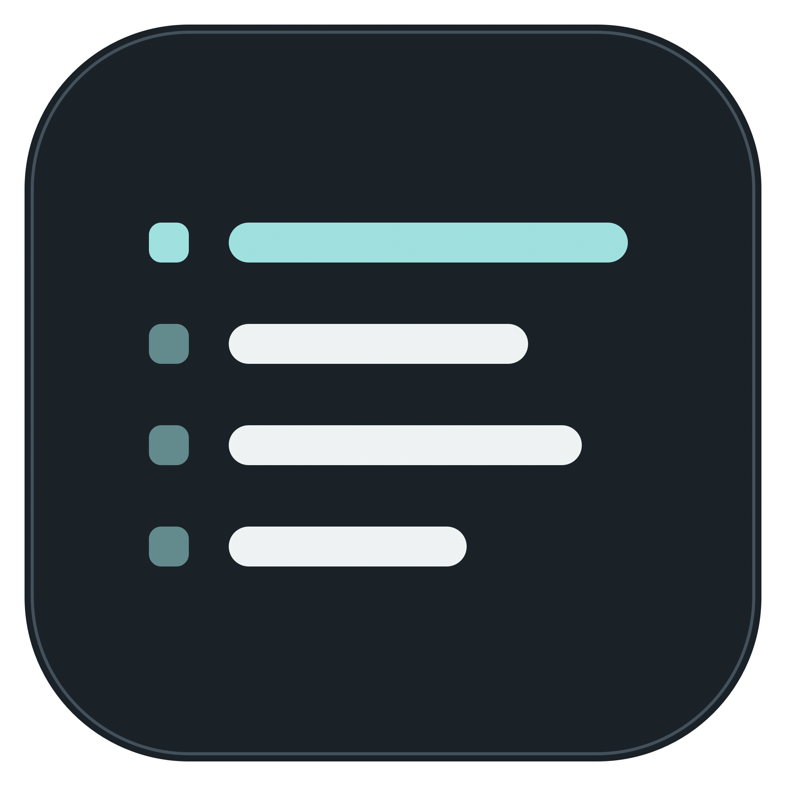
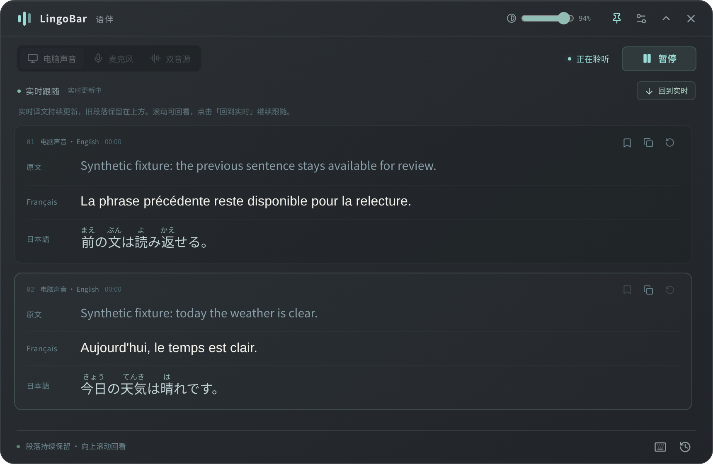

<div align="center">
  
  <h1>LingoBar · 语伴</h1>
  <p><strong>聞いている内容を、見比べて読み返せる多言語字幕に。</strong></p>
  <p>
    <a href="https://github.com/seihn2/lingobar/actions/workflows/build.yml?query=branch%3Amain"></a>
    <a href="LICENSE"></a>
    <a href="package.json"></a>
    <a href="package-lock.json"></a>
    <a href="package-lock.json"></a>
  </p>
  <p><a href="README.md">简体中文</a> · <a href="README.en.md">English</a> · <strong>日本語</strong></p>
</div>

[使い方ガイド](docs/usage.ja.md) · [インストール](#install) · [クイックスタート](#quick-start) · [貢献する](#contributing)

LingoBar は、語学学習のためのデスクトップ字幕ツールです。PC のシステム音声、マイクの音声、手入力したテキストを選んだ言語に翻訳し、軽量なフローティングウィンドウに原文、訳文、日本語の読みを並べて表示します。聞きながら読み、一文ずつ復習できます。

Electron、React、TypeScript で開発し、**非商用ライセンスの CC BY-NC 4.0 でソースを公開しています（source-available）**。現在のアプリ画面は主に簡体字中国語です。中国語・英語・日本語のドキュメントと、選択できる字幕の出力言語は、それぞれ独立しています。

<a id="validation"></a>
> [!IMPORTANT]
> **現在は開発プレビューで、ソースと CI のテストパッケージを配布しています。正式 release はまだありません。** Windows パッケージは未署名で、Windows 10/11 の実際の音声、デバイス、DPI 環境での動作は、引き続き実機での検証が必要です。ビルドの成功は実機検証の完了を意味しません。詳しくは[検証範囲](docs/windows-validation.md)を参照してください。



*現在の画面に合成字幕を表示し、Linux Chromium で実際にキャプチャした例です。Windows 実機で収音した画面ではありません。[スクリーンショットの出典](docs/images/README.md)*

<a id="overview"></a>
## 機能の概要

- **聞きながら対訳を読む。** システム音声、マイク、両方の音源に対応します。長い文も途中の認識結果から翻訳を始め、同じ区間を更新し続けます。授業、動画、会話の練習に使えます。
- **学習目的に合わせて言語を選ぶ。** 20 言語から 1～8 言語を選び、表示順を変更できます。初期設定は中国語・英語・日本語で、選択した言語だけを翻訳します。
- **日本語の読みを本文に添える。** 訳文を先に表示し、翻訳モデルが文脈に沿った振り仮名を対応する漢字の上に補います。振り仮名を待たずに読み始められます。
- **リアルタイムで追従し、立ち止まって読み返す。** 通常は最新の表示可能な訳文に追従します。スクロールや文字選択で過去の字幕を読み返し、**回到实时**（リアルタイム表示に戻る）で追従を再開できます。
- **復習したい一文を残す。** 小窓への切り替え、最前面表示、背景の透明度や文字サイズの調整ができます。完了した区間を保存し、Markdown の学習ノートに書き出せます。
- **履歴をローカルで検索。** 現在のソースでは、保持中の原文と取得済みの訳文を `Ctrl+F`／`⌘F` で検索できます。範囲と操作は[ガイド](docs/usage.ja.md#history)を参照してください。以前の `main` プレビューパッケージには含まれていないため、今回の改善 PR の成功したビルドを使うか、この変更を含むコミットからビルドしてください。

<a id="install"></a>
## インストール

| プラットフォーム | システム要件 | 入手方法 |
| --- | --- | --- |
| Windows | Windows 10/11、**x64** | [CI テストパッケージ](https://github.com/seihn2/lingobar/actions/workflows/build.yml?query=branch%3Amain)：対応する成功したビルドの Artifacts から ZIP をダウンロードし、展開してインストーラーを実行します。 |
| macOS | macOS 14.2 以降、Apple Silicon | [ソースからビルド](#development)して `dist/mac-arm64/LingoBar.app` を生成します。ローカルパッケージは ad-hoc 署名で、Apple の公証は受けていません。 |

Windows x64 対応は `main` にマージ済みです。それ以前に検証したテストパッケージとチェックサムの記録は [PR #2](https://github.com/seihn2/lingobar/pull/2) を参照してください。Windows ARM64 用のパッケージはまだ提供していません。CI artifact のダウンロードには GitHub へのログインが必要で、保存期間は 14 日です。期限切れの場合は、新しい成功したビルドを使うか、自分でビルドしてください。インストール前にパッケージ内の `SHA256SUMS.txt` を確認してください。インストール、更新、システム権限の詳しい手順は[使い方ガイド](docs/usage.ja.md#install)を参照してください。

<a id="quick-start"></a>
## クイックスタート

1. LingoBar を開き、**看看示例**（表示例を見る）で読み方を確認します。表示例は収音せず、サービスも呼び出しません。
2. **设置 → 服务连接**（設定 → サービス接続）で、音声認識と翻訳のサービスをそれぞれ設定し、**保存设置**（設定を保存）を押します。
3. **电脑声音**（システム音声）、**麦克风**（マイク）、**双音源**（両方の音源）から選びます。必要に応じて、設定で使いたいマイクをあらかじめ指定し、保存します。
4. **设置 → 字幕语言**（設定 → 字幕言語）で言語と表示順を選びます。必要であれば **日语汉字注音**（日本語の漢字に振り仮名を付ける）を有効にし、最後に設定を保存します。
5. **开始聆听**（聴き取りを開始）を押します。読み返した後は **回到实时**（リアルタイム表示に戻る）で追従を再開します。収音を終えるには **暂停**（一時停止）を押してください。ウィンドウを隠すだけでは停止しません。

グローバルショートカットは、Windows が **`Ctrl+Alt+L`**、Mac が **`⌘⌥L`** です。翻訳バーの表示／非表示を切り替えます。ドラッグ領域、透明度、手入力したテキストの翻訳、字幕の保存については[詳しいガイド](docs/usage.ja.md)を参照してください。

<a id="configuration"></a>
## サービス設定

| 用途 | 初期設定のサービスとモデル |
| --- | --- |
| リアルタイム音声認識 | DashScope 北京リージョン、`qwen-audio-3.1-asr-flash-streaming` |
| 字幕翻訳と任意の日本語振り仮名生成 | DeepSeek、`deepseek-flash` |

2 つのサービスには API Key をそれぞれ入力し、対応するモデルを利用できるアカウントが必要です。**オンラインの音声認識、翻訳、振り仮名生成には API 料金が発生する場合があります。** 字幕の翻訳先として選べる言語すべてを、ASR も認識できるとは限りません。遅延と認識できる言語の範囲は、ネットワーク、デバイス、モデルによって異なります。

各設定項目、接続プロトコル、権限の説明は[サービス設定ガイド](docs/usage.ja.md#services)を参照してください。デバイスの切り替えや接続に問題がある場合は、[トラブル対処表](docs/usage.ja.md#troubleshooting)を確認してください。

<a id="documentation"></a>
## ドキュメント

| 言語 | 使い方ガイド |
| --- | --- |
| 简体中文 | [安装、配置与日常使用](docs/usage.zh-CN.md) |
| English | [Installation, configuration and everyday use](docs/usage.en.md) |
| 日本語 | [インストール・設定・使い方](docs/usage.ja.md) |

開発とプラットフォームに関する資料：[Windows 移植の説明](docs/windows-port.md) · [テストマトリクス、既知の制限、ビルド記録](docs/windows-validation.md) · [第三者の出典](NOTICE.md)。

<a id="development"></a>
## 開発とビルド

Node.js **22.18 以降**と npm が必要です。ネイティブコンポーネントは対象プラットフォーム上でビルドします。

| プラットフォーム | 追加のツール |
| --- | --- |
| macOS | Apple Silicon、macOS 14.2 以降、Xcode Command Line Tools |
| Windows x64 | CMake 3.24 以降、Visual Studio 2022 の C++ デスクトップ開発ツール、Windows SDK |

`main` に Windows x64 対応が含まれています。ロックされた依存関係を使い、ローカルのプロジェクトを起動します。

```sh
git clone https://github.com/seihn2/lingobar.git
cd lingobar
git switch main
npm ci
npm run build:icons
npm run build:native
npm run dev
```

| コマンド | 用途 |
| --- | --- |
| `npm run typecheck` | TypeScript の型チェック |
| `npm test` | 主要なロジックと状態の回帰テスト |
| `npm run build` | 型チェックと本番用ビルド |
| `npm run test:media-permissions` | 実際の Electron を使った合成デバイスの権限チェック |
| `npm run test:ui` | インストール済み Chromium ブラウザーでの合成字幕の操作チェック |
| `npm run package:mac` | Mac アプリのディレクトリを生成 |
| `npm run package:win` | Windows x64 の NSIS インストーラーを生成 |

出力先は `dist/` です。ネイティブ helper、パッケージ内容、チェックサム一覧を確認するコマンドは[ビルドと検証](docs/windows-validation.md)を参照してください。

<a id="contributing"></a>
## 貢献する

対象が明確な修正、デバイスの互換性に関する報告、アクセシビリティの改善、テスト、ドキュメントの翻訳を歓迎します。問題を報告する際は、コミット番号、OS バージョン、音源またはデバイス、表示倍率、再現手順、期待した動作と実際の動作を記載してください：[GitHub Issues](https://github.com/seihn2/lingobar/issues)。

PR を提出する前に `npm run typecheck`、`npm test`、`npm run build` を実行してください。動作を変更する場合は、その変更を確かめられるテストを追加し、実際に検証したプラットフォームを明記してください。実デバイスの結果と合成テストの結果は分けて記録します。スクリーンショット、ログ、テスト fixture には、キー、録音、個人の字幕を含めないでください。

<a id="privacy-license"></a>
## プライバシーとライセンス

初回起動時に自動で収音することはなく、録音も保存しません。聴き取りを開始すると、設定した音声認識サービスに暗号化された接続で音声を送り、原文や手入力したテキストを翻訳サービスに送信します。キーはメインプロセスが Electron の `safeStorage` で暗号化します。暗号化が使えない場合や失敗した場合は保存を拒否し、平文での保存に切り替えることはありません。データの保持期間、システム権限、サービス提供者との責任範囲は[プライバシーの説明](docs/usage.ja.md#privacy)を参照してください。

本プロジェクトは [CC BY-NC 4.0](LICENSE) で公開しています。適切なクレジット、ライセンスの保持、変更の明示を条件に、非商用での利用、改変、共有が認められます。商用利用には別途許諾が必要です。ソースを公開するプロジェクトであり、OSI が定義するオープンソースソフトウェアではありません。第三者の依存コンポーネントには、それぞれのライセンスが適用されます。

音声コンポーネント、フレームプロトコル、ライフサイクル処理の一部は [Penumbra](https://github.com/seihn2/penumbra) を改変したものです。LingoBar の多言語学習画面と字幕の保存機能は独立して実装しています。出典のコミットと改変範囲は [NOTICE.md](NOTICE.md) を参照してください。
